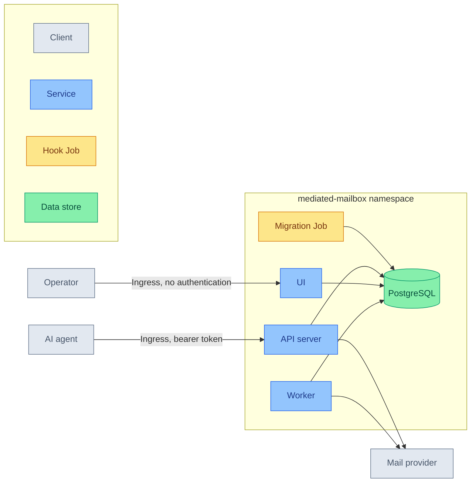

# Mediated Mailbox Subsystem

Gives AI agents mediated access to a mailbox through an API server that decides what each agent may read, with an operator UI for setting up accounts and policy.

## Quick Links

<a href="https://github.com/ppat/mediated-mailbox-mcp" target="_blank">Mediated Mailbox</a>

## Overview

The module deploys the project's own Helm chart from its OCI registry, pinned by tag and digest, together with a PostgreSQL cluster of its own.

1. Agent Access
   - An MCP and HTTP API server for agents
   - Bearer-token authentication on every request
   - Exposure outside the cluster through an Ingress, with no SSO in front
   - Mail content read through the server's policy, never directly

2. Background Processing
   - One worker pod running every background job kind
   - Backfill and delta sync against the mail provider

3. State and Credentials
   - A CloudNativePG cluster owned by the migrator's user
   - One application user that the API server, the UI and the worker connect as, created as a managed role, with its password kept in the secret store
   - Schema migrations run before every install and upgrade
   - Stored provider credentials sealed to a key pair from the secret store

4. Observability
   - A ServiceMonitor per deployable
   - The chart's alerting rules as a PrometheusRule
   - A Grafana dashboard in its own folder
   - A PodMonitor on the database

## Service Architecture

## Service Details

| Service | Primary Role | Key Features | Integration Points |
| --- | --- | --- | --- |
| API server | Agent-facing client surface | • MCP and HTTP roots • Bearer-token authentication • Ingress at `mediated-mailbox-api.${domain_name}` | • PostgreSQL as `mediated_mailbox_app` • Sealing key pair • Mail provider • Prometheus metrics |
| Worker | Background jobs | • Exactly one pod • Backfill and delta sync job kinds | • PostgreSQL as `mediated_mailbox_app` • Sealing key pair • Mail provider • Prometheus metrics |
| UI | Operator console for accounts and policy | • No login of its own and no authentication in front • Ingress at `mediated-mailbox.${domain_name}` • Request-token key generated by the chart | • PostgreSQL as `mediated_mailbox_app` • Sealing key pair • Prometheus metrics |
| Migration Job | Schema migrations | • Helm pre-install and pre-upgrade hook • Retries until the application user exists | • PostgreSQL as `mediated_mailbox_migrator`, with the password CloudNativePG generates |
| PostgreSQL | State storage | • CloudNativePG cluster with a generation suffix • The application user as a managed role • Server certificate checked with `verify-full` | • Every process and the migration Job • PodMonitor metrics |

## Prerequisites

1. Required Flux post-build variables

   | Name | Purpose | Used By |
   | --- | --- | --- |
   | `secret_store` | ClusterSecretStore the ExternalSecrets read from and the PushSecret writes to | ExternalSecrets `mediated-mailbox-secrets` and `mediated-mailbox-app-db`, PushSecret `mediated-mailbox-db-password` |
   | `domain_name` | Domain of the API server's and the UI's host names | API server and UI Ingresses |
   | `db_storage_size` | Database volume size | PostgreSQL |
   | `db_storage_class` | Database storage class | PostgreSQL |
   | `db_suffix_current` | Database cluster generation suffix | PostgreSQL, chart values |
   | `mediated_mailbox_db_password_key` | Secret store key of the application user's password | PushSecret `mediated-mailbox-db-password`, ExternalSecret `mediated-mailbox-app-db` |
   | `mediated_mailbox_sealing_publickey_key` | Secret store key of the sealing public key | ExternalSecret `mediated-mailbox-secrets` |
   | `mediated_mailbox_sealing_privatekey_key` | Secret store key of the sealing private key | ExternalSecret `mediated-mailbox-secrets` |
   | `mediated_mailbox_api_bearer_token_key` | Secret store key of the API server's bearer token | ExternalSecret `mediated-mailbox-secrets` |

2. Required secret store entries

   | Name | Purpose | Keys |
   | --- | --- | --- |
   | `${mediated_mailbox_db_password_key}` | Application user's password, generated and written by the module when absent | the password |
   | `${mediated_mailbox_sealing_publickey_key}` | Public key from the `keygen` subcommand of `mediated-mailbox-cli` | the key file, base64-encoded |
   | `${mediated_mailbox_sealing_privatekey_key}` | Private key from the `keygen` subcommand of `mediated-mailbox-cli` | the key file, base64-encoded |
   | `${mediated_mailbox_api_bearer_token_key}` | Bearer token agents present | the token |

## Notes

- **A rollback can fail on a newer schema.** A failed upgrade rolls back, as everywhere in this repository, and every pod checks the schema when it starts. A rollback across a migration that raised the schema's compatibility floor leaves the older pods refusing to start, and the way out is forward, to a release at or above the floor. The chart README's [Upgrades and the worker](https://github.com/ppat/mediated-mailbox-mcp/blob/main/packaging/chart/README.md#upgrades-and-the-worker) describes the check.
- **The sealing private key is the only copy that matters.** Every stored provider credential is sealed to it, so losing it loses them all. The secret store entry is the copy to back up. The `keygen` subcommand of `mediated-mailbox-cli` writes raw bytes, which is why the store holds each key base64-encoded and the ExternalSecret `mediated-mailbox-secrets` decodes it. The chart README's [Before you install](https://github.com/ppat/mediated-mailbox-mcp/blob/main/packaging/chart/README.md#before-you-install) gives the steps to get and verify the program and write the pair.
- **The UI is exposed with no authentication.** It has no login of its own and the module puts no proxy in front of it, so anyone who can reach `mediated-mailbox.${domain_name}` can set up accounts and policy. `ui.config.identity_header` is unset, so the UI shows its default operator name. The API server's bearer token is unaffected.
- **The secret store holds the application user's password, and its copy always wins.** `mediated-mailbox-app-db` reads the password from the store. A password is generated in the cluster only to seed the store, and the PushSecret writes it only where the store holds none, so a rebuilt cluster restores the password the database's role already has instead of generating a new one. CloudNativePG sets the managed role's password from the same Secret, so a database restored from backup gets the stored password as well. That Secret holds the password alone, because CloudNativePG lets the database pods read every managed role's password Secret, so the key pair and the bearer token sit apart in `mediated-mailbox-secrets`. The migrator's user's password is the one CloudNativePG generates into `<cluster>-app`.
