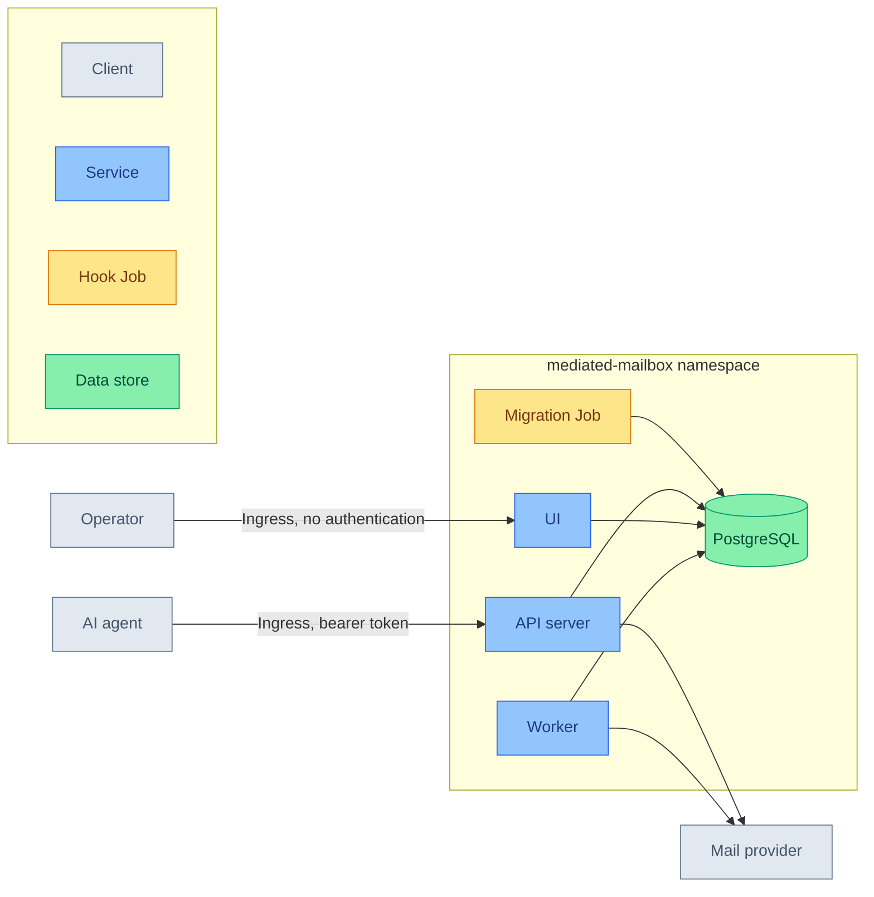

# Mediated Mailbox Subsystem

Gives AI agents mediated access to a mailbox through an API server that decides what each agent may read, with an operator UI for setting up accounts and policy.

## Quick Links

<a href="https://github.com/ppat/mediated-mailbox-mcp" target="_blank">Mediated Mailbox</a>

## Overview

The module deploys the project's own Helm chart from its OCI registry, pinned by tag and digest, together with a PostgreSQL cluster of its own and the secrets the chart reads from the cluster's secret store.

1. Agent Access
   - An MCP and HTTP API server for agents
   - Bearer-token authentication on every request
   - Exposure outside the cluster through an Ingress, with no SSO in front
   - Mail content read through the server's policy, never directly

2. Background Processing
   - One worker pod running every background job kind
   - Backfill and delta sync against the mail provider
   - Its own database role for each job kind

3. State and Credentials
   - A CloudNativePG cluster owned by the migration role
   - One database role per process, created as managed roles
   - Schema migrations run before every install and upgrade
   - Stored provider credentials sealed to a key pair from the secret store

4. Observability
   - A ServiceMonitor per deployable
   - The chart's alerting rules as a PrometheusRule
   - A Grafana dashboard in its own folder
   - A PodMonitor on the database

## Service Architecture

## Service Details

| Service | Primary Role | Key Features | Integration Points |
| --- | --- | --- | --- |
| API server | Agent-facing client surface | • MCP and HTTP roots • Bearer-token authentication • Ingress at `mediated-mailbox-api.${domain_name}` | • PostgreSQL as `mediated_mailbox_api` • Sealing key pair • Mail provider • Prometheus metrics |
| Worker | Background jobs | • Exactly one pod • Backfill and delta sync job kinds | • PostgreSQL as `mediated_mailbox_backfill` and `mediated_mailbox_sync` • Sealing key pair • Mail provider • Prometheus metrics |
| UI | Operator console for accounts and policy | • No login of its own and no authentication in front • Ingress at `mediated-mailbox.${domain_name}` • Request-token key generated by the chart | • PostgreSQL as `mediated_mailbox_ui` • Sealing key pair • Prometheus metrics |
| Migration Job | Schema migrations | • Helm pre-install and pre-upgrade hook • Retries until every role exists | • PostgreSQL as `mediated_mailbox_migrator`, from CloudNativePG's generated password file |
| PostgreSQL | State storage | • CloudNativePG cluster with a generation suffix • Six managed runtime roles • Server certificate checked with `verify-full` | • Every process and the migration Job • PodMonitor metrics |

## Prerequisites

1. Required Flux post-build variables

   | Name | Purpose | Used By |
   | --- | --- | --- |
   | `secret_store` | ClusterSecretStore the ExternalSecrets read from | ExternalSecrets |
   | `domain_name` | Domain of the API server's and the UI's host names | API server and UI Ingresses |
   | `db_storage_size` | Database volume size | PostgreSQL |
   | `db_storage_class` | Database storage class | PostgreSQL |
   | `db_suffix_current` | Database cluster generation suffix | PostgreSQL, chart values |
   | `api_db_password_remote_key` | Secret store key of the API server role's password | ExternalSecret `mediated-mailbox-api-db` |
   | `ui_db_password_remote_key` | Secret store key of the UI role's password | ExternalSecret `mediated-mailbox-ui-db` |
   | `backfill_db_password_remote_key` | Secret store key of the backfill role's password | ExternalSecret `mediated-mailbox-backfill-db` |
   | `sync_db_password_remote_key` | Secret store key of the delta sync role's password | ExternalSecret `mediated-mailbox-sync-db` |
   | `sealing_public_key_remote_key` | Secret store key of the sealing public key | ExternalSecret `mediated-mailbox-sealing-keys` |
   | `sealing_private_key_remote_key` | Secret store key of the sealing private key | ExternalSecret `mediated-mailbox-sealing-keys` |
   | `api_bearer_token_remote_key` | Secret store key of the API server's bearer token | ExternalSecret `mediated-mailbox-api-bearer-token` |

2. Required secret store entries

   | Name | Purpose | Keys |
   | --- | --- | --- |
   | `${api_db_password_remote_key}` | API server role password | the password |
   | `${ui_db_password_remote_key}` | UI role password | the password |
   | `${backfill_db_password_remote_key}` | Backfill role password | the password |
   | `${sync_db_password_remote_key}` | Delta sync role password | the password |
   | `${sealing_public_key_remote_key}` | Public key from `mediated-mailbox-keygen` | the key file, base64-encoded |
   | `${sealing_private_key_remote_key}` | Private key from `mediated-mailbox-keygen` | the key file, base64-encoded |
   | `${api_bearer_token_remote_key}` | Bearer token agents present | the token |

## Notes

- **A failed upgrade is retried, never rolled back.** The migration Job runs before any workload rolls and the project's migrations are forward-only, so a rollback would run the previous release's binaries against the newer schema. The HelmRelease therefore uses Flux's `RetryOnFailure` upgrade strategy, unlike the rest of this repository.
- **The chart reaches the database by the cluster's own `-rw` Service, not through an alias.** `verify-full` checks the host name against the server certificate, and the migration role's password file names that Service as its host. The host and the generated Secret names therefore carry `${db_suffix_current}`.
- **The sealing private key is the only copy that matters.** Every stored provider credential is sealed to it, so losing it loses them all. The secret store entry is the copy to back up. `mediated-mailbox-keygen` writes raw bytes, which is why the store holds each key base64-encoded and the ExternalSecret decodes it.
- **The UI is exposed with no authentication.** It has no login of its own and the module puts no proxy in front of it, so anyone who can reach `mediated-mailbox.${domain_name}` can set up accounts and policy. `ui.config.identity_header` is unset, so the UI shows its default operator name. The API server's bearer token is unaffected.
- **The UI and the API server each have a host name.** The chart lets them share one routed by path, but Traefik ranks routes by rule length, so the UI's exact `/` would lose to the API server's prefix `/` on a shared host unless a router priority were set.
- **Two roles hold no password.** `mediated_mailbox_organize` and `mediated_mailbox_propose` exist because the migrations grant to them, and belong to job kinds the chart does not run.
