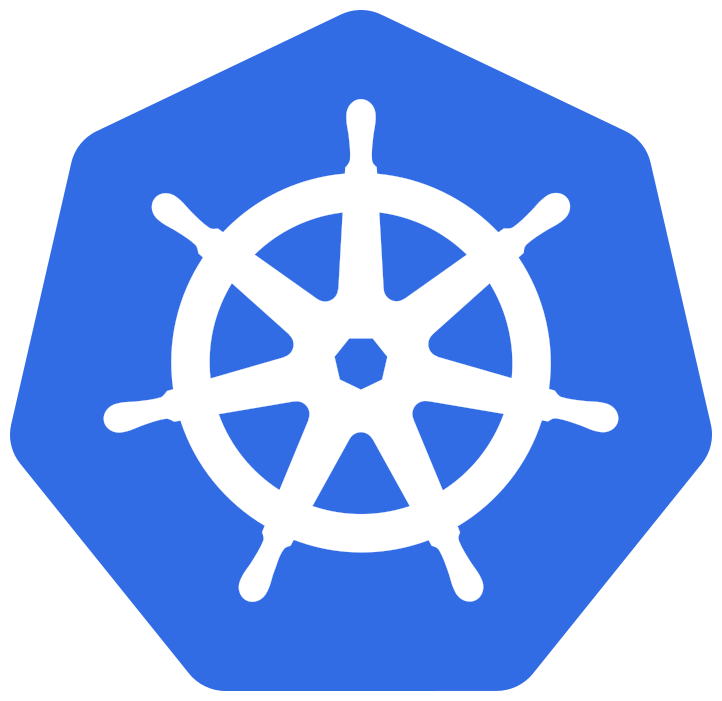

# Observability Extra

This module extends the core observability stack with specialized collectors and exporters for comprehensive system monitoring.

## Quick Links

     

## Overview

The observability-extra module provides six main capabilities:

1. Event Collection
   - Node problem detection:
     - System log monitoring
     - Kernel problem detection
     - Custom problem definitions
     - Prometheus alerts

2. Network Monitoring
   - SNMP metrics collection:
     - Custom scrape configurations
     - Instance relabeling
     - Anti-affinity rules
     - Timeout handling
   - UniFi statistics:
     - Site metrics
     - Device status
     - Network utilization
     - Secure credential handling

3. Log Aggregation
   - Syslog collection:
     - RFC3164 support (UDP/514)
     - RFC5424 support (TCP/601)
     - UTF-8 sanitization
     - Flow control
   - Performance features:
     - Connection pooling
     - Batch processing
     - Worker scaling
     - Buffer tuning

4. Synthetic Probing
   - Blackbox endpoint checks:
     - HTTP/HTTPS reachability (`http_2xx`), including TLS certificate expiry for `https://` targets
     - Bare TCP/TLS handshake checks (`tls_connect`) for non-HTTP TLS ports
     - Plain TCP port reachability (`tcp_connect`)
     - DNS resolution checks (`dns_udp`)
   - Cluster-wide `Probe` discovery:
     - No label or namespace selector required
     - Self-monitoring of the exporter's own metrics

5. Disk Health
   - SMART metrics from every node's disks (NVMe and SATA)
   - Alert rules labelled `capability: node.disk`:
     - Failed SMART health assessment (NVMe temperature-only warnings excluded)
     - Media or sector errors increasing within 24 hours
     - NVMe wear above 90 percent of rated endurance
     - Exporter pods missing from scraping
     - A heartbeat showing the rules are evaluated

6. Health Canaries
   - Scheduled checks that exercise a capability end to end, in the `health-canary` namespace
   - Pod networking and cluster DNS (`netcheck`):
     - An echo pod on every node, behind a headless Service that keeps not-ready pods in DNS
     - A CronJob every 10 minutes that resolves the Service and calls every echo pod
     - Each echo pod answers with its node name, so a reply proves which pod answered
   - Storage (`block-canary-<name>`, `nfs-canary-<name>`), one instance per StorageClass or volume:
     - Every 6 hours, a fresh PVC from a generic ephemeral volume, deleted with the run's pod
     - 64 MiB written with O_DIRECT and fsync, read back with O_DIRECT, checksum compared with the written stream
     - A variant against an existing PVC, for storage only consumed through pre-provisioned volumes
   - Object storage (`s3-canary-<name>`), one instance per S3 endpoint:
     - Hourly PUT, GET with checksum, LIST and DELETE in a canary bucket, with a key scoped to it
     - A missing credentials Secret fails the run with a message naming it
   - Alert rules read canary outcomes from kube-state-metrics CronJob status, labelled `capability: net.pod`,
     `storage.block`, `storage.nfs` or `storage.object`:
     - Latest scheduled run not successful
     - No success within three schedule intervals, or the canary suspended
     - A node without an echo pod
     - A canary volume still present two hours after its run
     - Canary metrics missing altogether
     - A heartbeat per capability

### Component Architecture

```mermaid
flowchart TB
    %% Color scheme
    classDef event fill:#a7f3d0,stroke:#059669,color:#064e3b
    classDef network fill:#bfdbfe,stroke:#3b82f6,color:#1e3a8a
    classDef log fill:#fecaca,stroke:#dc2626,color:#7f1d1d
    classDef storage fill:#fde68a,stroke:#d97706,color:#92400e
    classDef probe fill:#ddd6fe,stroke:#7c3aed,color:#4c1d95
    classDef infra fill:#e5e7eb,stroke:#6b7280,color:#374151
    classDef legend fill:none,stroke:none,color:#6b7280

    %% Event Sources
    subgraph events["Event Collection"]
        direction TB
        node-problems["Node Problems"]:::event
        problem-detector["Problem Detector"]:::event
    end

    %% Network Sources
    subgraph network["Network Monitoring"]
        direction TB
        snmp-devices["SNMP Devices"]:::network
        unifi-devices["UniFi Devices"]:::network
        snmp-exporter["SNMP Exporter"]:::network
        unpoller["UniFi Poller"]:::network
    end

    %% Log Sources
    subgraph logs["Log Collection"]
        direction TB
        rfc3164["Syslog UDP/514<br/>RFC3164"]:::log
        rfc5424["Syslog TCP/601<br/>RFC5424"]:::log
        syslog-ng["Syslog-ng<br/>Aggregator"]:::log
    end

    %% Probing
    subgraph probing["Synthetic Probing"]
        direction TB
        probe-targets["Probed Endpoints<br/>(HTTP/TCP/DNS)"]:::probe
        blackbox-exporter["Blackbox Exporter"]:::probe
    end

    %% Disk Health
    subgraph disks["Disk Health"]
        direction TB
        node-disks["Node Disks<br/>(NVMe/SATA)"]:::event
        smartctl-exporter["smartctl Exporter"]:::event
    end

    %% Health Canaries
    subgraph canaries["Health Canaries"]
        direction TB
        netcheck["netcheck<br/>CronJob"]:::probe
        echo["netcheck-echo<br/>(every node)"]:::probe
        storagecanary["storage canary<br/>CronJob per StorageClass"]:::probe
        scratch["per-run PVC"]:::storage
        s3canary["S3 canary<br/>CronJob per endpoint"]:::probe
    end

    %% Storage
    subgraph storage["Storage Layer"]
        direction TB
        loki["Loki<br/>Log Storage"]:::storage
        prometheus["Prometheus<br/>Metrics Storage"]:::storage
    end

    %% Event Flow
    node-problems --> problem-detector
    problem-detector --> prometheus

    %% Disk Flow
    node-disks --> smartctl-exporter
    smartctl-exporter --> prometheus

    %% Network Flow
    snmp-devices --> snmp-exporter
    unifi-devices --> unpoller
    snmp-exporter --> prometheus
    unpoller --> prometheus

    %% Log Flow
    rfc3164 --> syslog-ng
    rfc5424 --> syslog-ng
    syslog-ng --> loki

    %% Probing Flow
    blackbox-exporter --> probe-targets
    blackbox-exporter --> prometheus

    %% Canary Flow
    netcheck --> echo
    netcheck -. "CronJob status via<br/>kube-state-metrics" .-> prometheus
    storagecanary --> scratch
    storagecanary -. "CronJob status via<br/>kube-state-metrics" .-> prometheus
    s3canary --> s3endpoint["S3 endpoint<br/>canary bucket"]:::storage
    s3canary -. "CronJob status via<br/>kube-state-metrics" .-> prometheus

    %% Legend
    subgraph Legend[" "]
        direction LR
        event-l["Events"]:::event
        network-l["Network"]:::network
        log-l["Logs"]:::log
        probe-l["Probing"]:::probe
        storage-l["Storage"]:::storage
        style Legend fill:none,stroke:none
    end
```

### Component Details

| Component | Primary Role | Integration Points |
| ----------- | ------------- | ------------------- |
| Blackbox Exporter | Endpoint probing | • HTTP/TCP/DNS `Probe` modules • Cluster-wide `Probe` discovery • TLS certificate expiry • Self-monitoring ServiceMonitor • `PrometheusRule` alerting when the cluster DNS probe mostly fails or stops reporting |
| Problem Detector | Node monitoring | • System log analysis • Kernel monitoring • PrometheusRules • ServiceMonitor enabled |
| Health canaries: netcheck | Pod networking and cluster DNS canary | • Echo DaemonSet tolerating every taint • Headless Service publishing not-ready addresses • CronJob every 10 minutes, one attempt, no API access • `PrometheusRule` alerting on failed, stale or suspended runs and nodes without an echo pod |
| Health canaries: storage | Block and NFS storage canary, one instance per StorageClass | • Separate template directory, instantiated by the consuming cluster per class • Generic ephemeral volume per run: no API access, cleanup by garbage collection • Claim variant for an existing PVC • `PrometheusRule` alerting on failed, stale or suspended runs and on volumes left behind |
| Health canaries: S3 | Object storage canary, one instance per endpoint | • Separate template directory, instantiated by the consuming cluster per endpoint • Credentials from an optional Secret supplied by the cluster • Runs on the `ppatlabs/health-canary` image (s5cmd) • `PrometheusRule` alerting on failed, stale or suspended runs |
| smartctl Exporter | Disk health | • Privileged DaemonSet on every node • ServiceMonitor with `node` label • PrometheusRules |
| SNMP Exporter | Network metrics | • Custom scrape configs • Instance relabeling • Anti-affinity rules • Timeout handling |
| Syslog-ng | Log aggregation | • Dual protocol support • Batch processing • Worker scaling • Flow control |
| UniFi Poller | Network stats | • Site monitoring • Device metrics • Secure credentials • Prometheus integration |

## Prerequisites

1. Required Components

   | Component  | Purpose         | Configuration           |
   |------------|-----------------|-------------------------|
   | Loki       | Log storage     | From observability-core |
   | Prometheus | Metrics storage | From observability-core |

2. Required Variables

   | Variable    | Purpose                               | Example     |
   |-------------|---------------------------------------|-------------|
   | dns_zone    | UniFi URL                             | example.com |
   | domain_name | Blackbox `Probe` HTTP target hostname | example.com |

3. Required Secrets

   | Secret Name          | Purpose      | Required Keys                        |
   |----------------------|--------------|--------------------------------------|
   | unpoller-credentials | UniFi access | unpoller_username, unpoller_password |

4. Storage canary instance variables

   Set on each Flux Kustomization that points at `health-canaries/storage` or `health-canaries/storage-claim`. These
   paths are not part of the module root build.

   | Variable                   | Purpose                                                                 | Used by         |
   |----------------------------|-------------------------------------------------------------------------|-----------------|
   | storage_canary_name        | Instance name, the suffix of the CronJob name                           | both            |
   | storage_canary_kind        | `block` (default) or `nfs`; selects the alert capability                | both            |
   | storage_canary_class       | StorageClass to provision from; must have `reclaimPolicy: Delete`       | `storage`       |
   | storage_canary_access_mode | PVC access mode, default `ReadWriteOnce`                                | `storage`       |
   | storage_canary_size        | PVC size, default `1Gi`                                                 | `storage`       |
   | storage_canary_claim       | Existing PVC in the `health-canary` namespace                           | `storage-claim` |

5. S3 canary instance variables

   Set on each Flux Kustomization that points at `health-canaries/s3`, which is not part of the module root build.

   | Variable           | Purpose                                                        | Used by |
   |--------------------|----------------------------------------------------------------|---------|
   | s3_canary_name     | Instance name, the suffix of the CronJob and Secret names      | `s3`    |
   | s3_canary_endpoint | S3 endpoint URL, as the endpoint's real clients address it     | `s3`    |
   | s3_canary_bucket   | Bucket the canary writes to, under the `health-canary/` prefix | `s3`    |
   | s3_canary_region   | Signing region, default `us-east-1`                            | `s3`    |

6. S3 canary secrets

   | Secret Name                   | Purpose                                                               | Required Keys                            |
   |-------------------------------|-----------------------------------------------------------------------|------------------------------------------|
   | s3-canary-`${s3_canary_name}` | Key scoped to the canary bucket, from the cluster; optional to render | AWS_ACCESS_KEY_ID, AWS_SECRET_ACCESS_KEY |

7. Storage requirements

   | PVC name                    | Purpose                                     | Access mode                    |
   |-----------------------------|---------------------------------------------|--------------------------------|
   | `${storage_canary_claim}`   | Volume the `storage-claim` canary writes to | provisioned by the cluster     |

## Dependencies

### Required By

- Application modules requiring:
  - Network metrics
  - Log aggregation
  - Problem detection

### Depends On

- [observability-core](../observability-core) - For storage backends

## Notes

- **Canary instances live in the consuming cluster.** Kustomize cannot loop over a list, so the per-StorageClass
  canary is a template directory that each cluster instantiates once per class with its own Flux Kustomization.
  Each instance is its own CronJob, so its alerts name the class, and one hung provisioner cannot block another.
  Instances depend on the module root, which provides the namespace and the scripts ConfigMap.
- **Retain classes leak a volume per run.** A run's PVC is deleted with its pod. On a `reclaimPolicy: Retain` class
  the PV is only Released and the backing volume stays, every 6 hours. Point the canary at a Delete class with the
  same provisioner and parameters; `CanaryVolumeLeftBehind` fires if one is missed.
- **Volumes inherit the class's recurring jobs.** On Longhorn, a class's `recurringJobSelector`, or the `default`
  group when it has none, applies to canary volumes for the minutes they exist. A canary class should select a
  group that has no jobs, so a run never lands a snapshot or backup in a real target.
- **Point S3 canaries at the URL the endpoint's clients use.** A canary on the in-cluster Service address does not
  exercise the ingress, TLS and DNS path a backup client in another cluster takes. Give each instance its own bucket
  and a key scoped to it; a run only leaves an object behind when its own DELETE fails, and that run fails.
- **The schedule is not a variable.** A cron expression starting with `*` would be read as a YAML alias after
  substitution. Change it with a patch; the alert rules derive each canary's interval from the CronJob.
